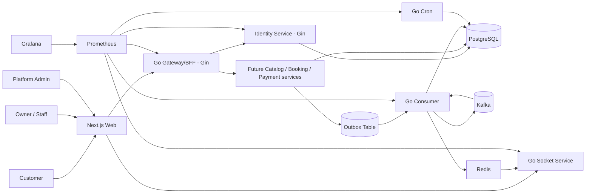

# High-Level Design

## Architecture

## Components

- Next.js Web: public marketplace, customer, owner, staff, and admin UI.
- Go Gateway/BFF: public HTTP routes, request forwarding, API compatibility, and edge readiness.
- Identity Service: users, credentials, refresh sessions, JWT issuance, and `/api/v1/me`.
- Future domain services: Catalog, Booking, and Payment own their state only after their extraction phases are implemented.
- PostgreSQL: authoritative business state and overlap protection.
- Redis: cache, rate limiting, and WebSocket presence.
- Kafka: durable asynchronous domain events.
- Redis Pub/Sub: low-latency fan-out to every Socket instance.
- Go Consumer: outbox publishing, Kafka consumption, notifications, realtime dispatch, and retries.
- Go Cron: scheduled hold expiration and payout processing.
- Go Socket Service: authenticated connections, Redis Pub/Sub subscription, and local real-time broadcast.

## Key Decisions

- Phase 1 has a public `api` Gateway and a private `identity` service; Socket, Consumer, and Cron remain independently deployable workers.
- Domain services are extracted incrementally by ownership; no service is created for an unimplemented module.
- Shared database with strict `organization_id` authorization.
- PostgreSQL, not Redis, prevents double booking.
- Transactional outbox protects database-to-Kafka delivery.
- Consumer bridges selected Kafka events to Redis Pub/Sub for horizontal Socket scaling.
- Consumer scales with Kafka partitions. Cron scales separately and uses distributed locking plus idempotent jobs.
