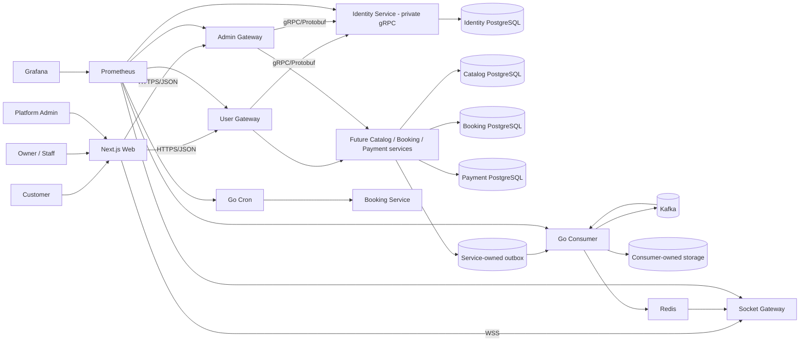

# High-Level Design

## Architecture



## Components

The database nodes in the diagram represent logical ownership boundaries. The
initial deployment may co-locate service schemas in one PostgreSQL database;
each service still has separate credentials, migrations, repositories, and
schema access. A service can move to a dedicated database without changing its
domain or gRPC/event contracts.

## Request boundary

```text
Browser / FE -- HTTPS + JSON --> User Gateway
Browser / FE -- HTTPS + JSON --> Admin Gateway
Browser / FE -- WSS --> Socket Gateway
User/Admin/Socket Gateway -- gRPC + Protobuf --> owning service
owning service -- PostgreSQL/Redis --> service-owned infrastructure
```

The three gateways are the only frontend boundaries. The frontend never calls a
service directly. A service does not expose a business HTTP API to the
frontend; gateway-to-service calls use versioned gRPC contracts under
`contracts/proto/`. HTTP health probes are operational exceptions.

- Next.js Web: public marketplace, customer, owner, staff, and admin UI.
- User Gateway: public user HTTPS/JSON routes, HTTP-to-gRPC translation, and edge readiness.
- Admin Gateway: private admin HTTPS/JSON routes, HTTP-to-gRPC translation, and edge readiness.
- Socket Gateway: WSS/WebSocket protocol handling and service integration.
- Identity Service: private gRPC methods for users, credentials, refresh sessions, JWT issuance, and current-user lookup.
- Future domain services: Catalog, Booking, and Payment own their state only after their extraction phases are implemented.
- PostgreSQL: authoritative business state and overlap protection.
- Redis: cache, rate limiting, and WebSocket presence.
- Kafka: durable asynchronous domain events.
- Redis Pub/Sub: low-latency fan-out to every Socket instance.
- Go Consumer: outbox publishing, Kafka consumption, notifications, realtime dispatch, and retries.
- Go Cron: scheduled hold expiration and payout processing.
- Go Socket Service: authenticated connections, Redis Pub/Sub subscription, and local real-time broadcast.

## Key Decisions

- Phase 1 has public User/Admin/Socket Gateways and a private Identity gRPC service; Consumer and Cron remain independently deployable workers.
- Domain services are extracted incrementally by ownership; no service is created for an unimplemented module.
- Each stateful service owns a logical PostgreSQL boundary, credentials,
  migration history, and strict `organization_id` authorization within its own
  data. Initial environments may co-locate service schemas in one PostgreSQL
  database; services never query another schema, and each service can move to a
  separate database when scaling requires it.
- PostgreSQL, not Redis, prevents double booking.
- Transactional outbox protects database-to-Kafka delivery.
- Consumer bridges selected Kafka events to Redis Pub/Sub for horizontal Socket scaling.
- Consumer scales with Kafka partitions. Cron scales separately and uses distributed locking plus idempotent jobs.
