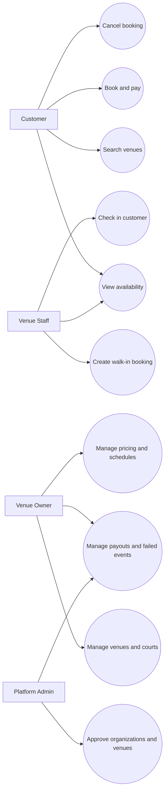

# Use Case Diagram

The design with actors and their system actions is called a **Use Case Diagram**.

## Access Boundary

- Customers access only their bookings.
- Owners access only their organizations.
- Staff access only assigned venues.
- Admins access platform-wide operations.
