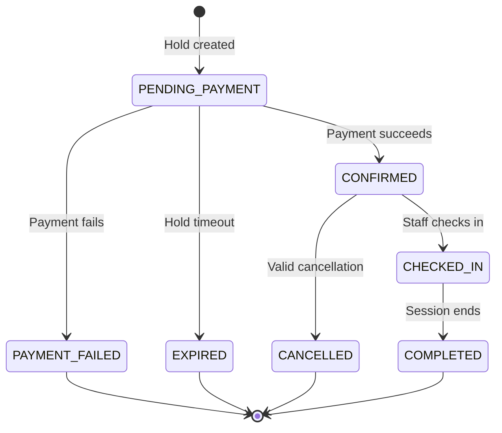

# Booking State Machine

## Rules

- The server owns transitions.
- Every transition is validated and audited.
- Payment callbacks are idempotent.
- An expired hold cannot become confirmed automatically.
- A completed or cancelled booking is terminal.
